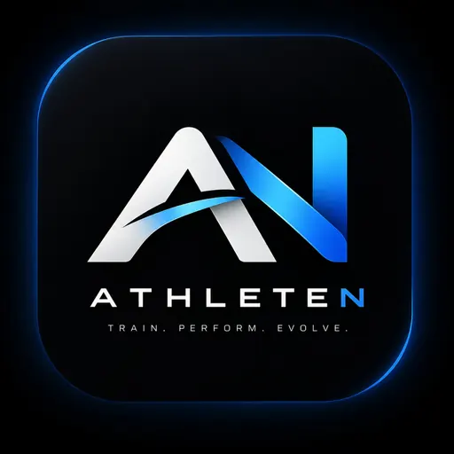
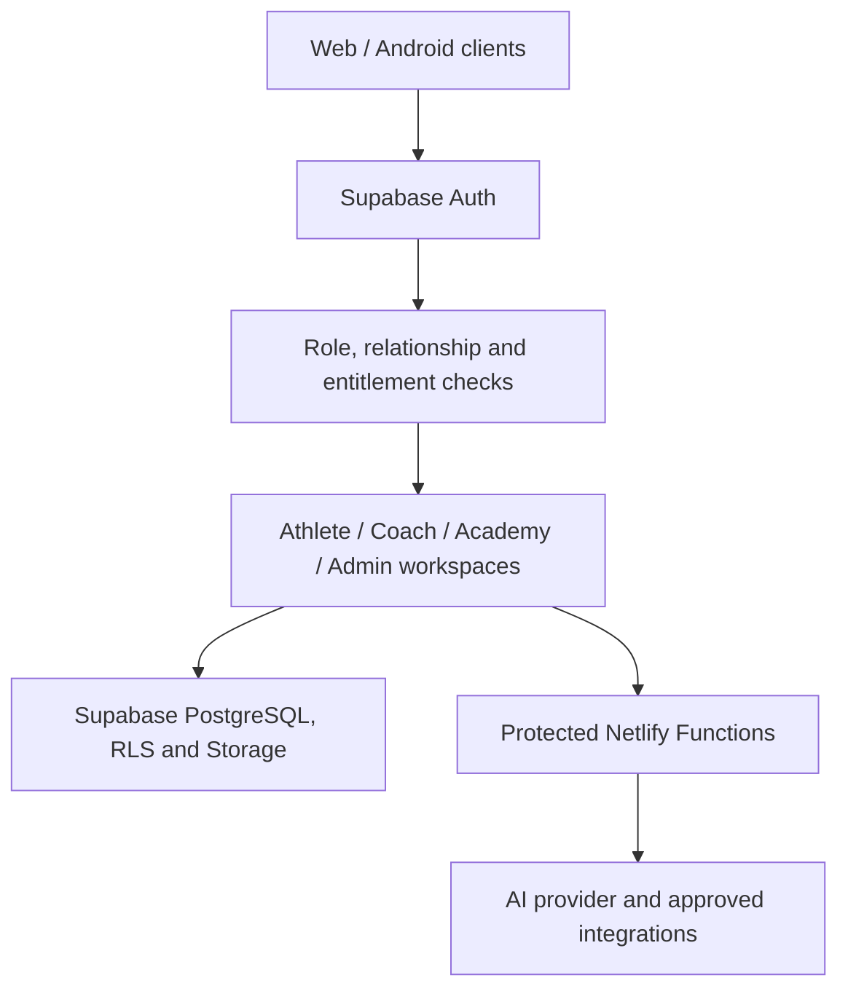

<div align="center">



# AthleteN

### THE ATHLETE OPERATING SYSTEM

**Train Smarter. Compete Stronger.**


**Built by Nova Code**

[Open AthleteN](https://athleten.netlify.app) · [Documentation](./docs/README.md) · [Android guide](./AthleteN-Mobile/README.md) · [Current release status](./docs/RELEASE_STATUS_2026-11-27.md)

</div>

---

> **Release status: not production-approved.** AthleteN is actively developed. The current candidate has outstanding Android startup/device acceptance, production migration-history reconciliation, security and configuration review, billing/rewarded-ad readiness, and release-signing gates. Paid checkout and rewarded ads are not live. See the [dated release status](./docs/RELEASE_STATUS_2026-11-27.md).

## What is AthleteN?

AthleteN is a Taekwondo-first athlete platform that connects training records, competition preparation, development, coaches and academy operations in one workspace.

Athletes choose Taekwondo and then their discipline:

- **Kyorugi** — sparring training, bout records and competition results.
- **Poomsae** — forms practice, repetitions, categories, scores and placings.

The athlete journey:

**TRAIN → TRACK → PREPARE → COMPETE → REVIEW → IMPROVE**

## Product workspaces

| Workspace | Purpose |
|---|---|
| 🥋 Athlete | Profile, training, goals, competitions, medals, certificates, milestones, documents and journey |
| 🧑‍🏫 Coach | Authorized roster, athlete progress, training, attendance, communication and supported reports |
| 🏟️ Academy | Members, coaches, operations, attendance, announcements, fees and reports where implemented |
| 🛡️ Admin | Verification, support, scoped operations, audit and platform controls |

## Feature areas

- Training logs, history, goals and progress
- Taekwondo discipline workflows: Kyorugi and Poomsae
- Competitions, event history, bout/performance records
- Medals, certificates, badges and athlete milestones
- Calendar, attendance, Athlete Journey and documents
- Coach-athlete and Academy relationships
- Messaging, groups, search, reactions, message actions and attachments (implementation/acceptance status varies)
- Notifications and preferences
- AI Coach and reports with server-side eligibility, usage and budget controls
- Rewards Centre and optional rewarded-ad credit foundation
- Daily leaderboard with privacy-preserving opt-in and aliases
- Verification, parent/guardian access workflows and admin controls

Feature screens are not proof of production readiness. The [feature inventory](./docs/FEATURES.md) distinguishes implementation from test, staging and production acceptance.

## Web and Android

| Client | Stack | Role |
|---|---|---|
| Web | React 18, TypeScript, Vite, React Router | Detailed dashboards, history, analytics, reports and administration |
| Android | React Native, Expo SDK 57, Expo Router | Daily athlete/coach actions, capture, messaging and focused mobile workflows |

Both clients share identity, backend records and server/database authorization. Web/mobile feature parity and physical-device behaviour are still being validated.

## Pricing discussed and product-owner confirmed

This is the pricing catalogue discussed for AthleteN product planning. **It is not yet aligned with the repository's current pricing source code**; see [Pricing & Financial Controls](./docs/PRICING_AND_FINANCIAL_CONTROL_V1.md) for the mismatch and implementation gate.

| Plan | Monthly | Annual | AI allowance / month |
|---|---:|---:|---:|
| Free | ₹0 | ₹0 | 0 base requests |
| Student | ₹49 | ₹499 | **40** |
| Pro | ₹199 | ₹1,999 | 200 |
| Elite | ₹399 | ₹3,999 | 500 |
| Coach | ₹499 | ₹4,999 | 750 |
| Academy | ₹799 | ₹7,999 | 1,000 shared |

Prices are proposed customer-facing totals, intended to be inclusive of applicable GST; tax treatment and invoices require qualified review before billing. Checkout, recurring billing and the seven-day trial are not enabled.

### Optional rewarded-ad credits — planned, not live

- One successfully verified rewarded ad: **2 bonus AI messages**
- Limit: **3 successful ads/day**
- Limit: **30 ad-earned messages/month**
- Credits are separate from plan allowance and expire at month-end.
- Watching ads is optional and must not restrict existing app access.
- Youth privacy, age-appropriate ad configuration, consent, publisher approval and native-device acceptance are required before activation.

## Architecture



### Technology

- **Web:** React, TypeScript, Vite, React Router, Recharts
- **Mobile:** React Native, Expo SDK 57, Expo Router
- **Backend:** Supabase Auth, PostgreSQL, Row Level Security, Storage and Realtime
- **Server:** Netlify Functions
- **AI:** server-side OpenAI API integration
- **CI/security:** GitHub Actions, Node tests, build checks, CodeQL and dedicated SQL integration workflows

## Getting started

### Prerequisites

- Node.js **22.x**
- npm and Git
- Supabase project credentials for connected features
- Android device or emulator for mobile testing

### Web

From the repository root:

```bash
npm ci
npm run dev
```

The development command uses Netlify Dev to serve the Vite app and local functions. For Vite-only UI work:

```bash
npm run dev:vite
```

Checks:

```bash
npm test
npm run build
npm run check
```

### Android

```bash
cd AthleteN-Mobile
npm ci
npx expo start --clear
```

Run on Android:

```bash
npx expo start --android
```

Native build:

```bash
npx expo run:android
```

Mobile checks:

```bash
npm test
npx tsc --noEmit
npx eslint .
npx expo-doctor
```

See [Development](./docs/Development.md) and [AthleteN-Mobile README](./AthleteN-Mobile/README.md) for environment, native setup and device acceptance details.

## Environment and secrets

Client-side values are limited to public configuration such as Supabase URL and anon/public key. Server secrets—including Supabase service-role credentials, OpenAI keys, payment secrets, webhook secrets and private signing material—must remain in server environment configuration and never be committed or embedded in client builds.

## Repository layout

```text
AthleteN/
├── src/                         Web application
├── AthleteN-Mobile/              React Native / Expo app
├── netlify/functions/            Server-side API functions
├── supabase/migrations/          Candidate/versioned database changes
├── supabase/security/            Security SQL and review material
├── tests/                        Automated tests
├── docs/                         Product, engineering and release guides
├── public/                        Web assets
└── .github/workflows/             CI, security and Android workflows
```

## Documentation

| Guide | Purpose |
|---|---|
| [Documentation Hub](./docs/README.md) | Full documentation index |
| [Feature Inventory](./docs/FEATURES.md) | Implemented, partial, planned and gated feature status |
| [Roadmap](./docs/ROADMAP.md) | Product and engineering priorities |
| [Current Release Status](./docs/RELEASE_STATUS_2026-11-27.md) | Current known blockers and evidence boundaries |
| [Release Checklist](./docs/RELEASE_CHECKLIST.md) | Release acceptance gates |
| [Known Issues](./docs/KNOWN_ISSUES.md) | Current investigations and workarounds |
| [Plans and Billing](./docs/PLAN_VERIFICATION_AND_BILLING.md) | Eligibility, billing and checkout safety |
| [Pricing Controls](./docs/PRICING_AND_FINANCIAL_CONTROL_V1.md) | Pricing, AI allowance and budget policy |
| [Architecture](./docs/Architecture.md) | System boundaries |
| [Development](./docs/Development.md) | Local setup and validation |
| [Deployment](./docs/Deployment.md) | Controlled deployment guidance |
| [Security](./docs/SECURITY.md) | Security reporting and practices |
| [Web/Mobile Model](./docs/WEB_MOBILE_EXPERIENCE_MODEL.md) | Client responsibilities and parity |
| [Mobile Guide](./AthleteN-Mobile/README.md) | Expo and Android setup |

## Release principles

1. A screen is not proof that its feature works end-to-end.
2. CI is not production or physical-device acceptance.
3. Candidate migrations must be reconciled and replayed in isolated staging before production changes.
4. RLS and server authorization are the real permission boundary.
5. Checkout, ads, AI and external integrations stay fail-closed until their safety gates pass.
6. Release evidence must reference the exact commit and workflow run.
7. Never claim a feature is live if it is only coded, tested in isolation or awaiting configuration.

---

<div align="center">

**AthleteN — one connected operating system for the athlete journey.**

Made by **Nova Code**

</div>
