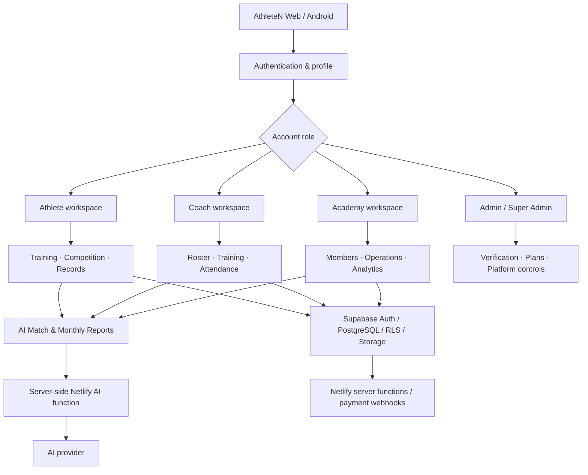

<div align="center">

# 🥋 AthleteN

### THE ATHLETE OPERATING SYSTEM

**Train Smarter. Compete Stronger.**

<p>
  
  
  
  
</p>

**Built by Nova Code** · React · TypeScript · Expo · Supabase · Netlify

[Platform Guide](./docs/ATHLETEN_PLATFORM_GUIDE.md) · [Web + Mobile Experience](./docs/WEB_MOBILE_EXPERIENCE_MODEL.md) · [Taekwondo Disciplines](./docs/TAEKWONDO_DISCIPLINES.md) · [Plans & Verification](./docs/PLAN_VERIFICATION_AND_BILLING.md) · [Docs Hub](./docs/README.md) · [API](./docs/API.md) · [Release Status](./docs/APS_1.0_IMPLEMENTATION_STATUS_2026-11-03.md) · [Mobile Guide](./AthleteN-Mobile/README.md)

</div>

---

## 🌌 What is AthleteN?

AthleteN is a sports-focused operating system for the people behind an athlete's journey: **athletes, coaches and academies**.

It connects the everyday work that happens before, during and after competition:

`TRAIN → TRACK → PREPARE → COMPETE → REVIEW → IMPROVE`

Instead of spreading training logs, results, medals, attendance, goals, reports and communication across disconnected tools, AthleteN brings them into one permission-aware workspace.

The product is **Taekwondo-first**, with Kyorugi and Poomsae workflows at its core. Its role-based architecture can support other sports as the product expands.

> **The idea:** one connected place for an athlete's progress, a coach's work and an academy's operations.

---

## ✨ Explore the platform

<table>
<tr>
<td width="50%" valign="top">

### 🥋 Athlete workspace
- Athlete profile and sports identity
- Training sessions and training history
- Sport-first Taekwondo selection with separate Kyorugi and Poomsae workspaces, labels, practice logs and competition records
- Tournaments, matches and competition history
- Medals, achievements and certificates
- Goals, milestones and athlete journey
- Weight records and competition category history
- Documents, calendar and checklists
- Attendance and notifications
- Connected coach and academy relationships

</td>
<td width="50%" valign="top">

### 🧑‍🏫 Coach workspace
- Coach identity and athlete connections
- Athlete roster and relationship management
- Training plans and session monitoring
- Attendance and progress overview
- Competition and medal summaries
- Athlete-specific review and feedback
- Coach monthly intelligence report
- Communication and notifications
- Coach plan and role-based access

</td>
</tr>
<tr>
<td width="50%" valign="top">

### 🏟️ Academy workspace
- Academy profile and setup
- Academy owner and coach relationships
- Athlete and coach memberships
- Attendance and training operations
- Competition and medal overview
- Academy analytics and reporting
- Academy announcements and calendar
- Academy monthly intelligence report
- Academy plan and role-based access

</td>
<td width="50%" valign="top">

### 🛡️ Platform administration
- Admin and Super Admin workspaces
- Student verification review
- User and role administration
- Subscription and usage management
- Support, announcements and feature controls
- Badge and achievement management
- Audit and operational records
- Controlled app-release management

</td>
</tr>
</table>

---

## 🤖 AthleteN Intelligence

AI features are designed around recorded sports context, not made-up performance statistics.

### 🥊 AI Match Report

A paid feature for eligible Athletes, Coaches and Academies.

The report uses information supplied in AthleteN: event, opponent or style when known, result, score when recorded, and match observations. It produces a structured review containing:

- Match summary
- Supplied observations and recorded strengths
- Areas to review with a coach
- Tactical lessons and questions
- Practical next-practice priorities

**Accuracy rule:** the report must not invent scoring events, techniques, statistics or claim to have analysed footage when no video analysis was performed.

### 📊 AI Monthly Reports

A paid reporting feature with role-specific reports:

| Account | Monthly report |
|---|---|
| 🥋 Athlete | Personal training, attendance, medals, competitions and goal summary |
| 🧑‍🏫 Coach | Summary for the coach's own account and linked athletes they are authorized to manage |
| 🏟️ Academy | Academy-level summary for permitted academy athletes and activity |

Reports are based on the **previous completed calendar month** and actual records available to the account. The AI must label missing data rather than invent it. The current report workflow is user-initiated; scheduled delivery is not claimed as enabled.

### 🔐 AI access rules

- Free plan: no AI Match Reports or AI Monthly Reports.
- Eligible paid plan and matching account role are required.
- Student requires the latest Student verification request to be approved.
- Coach and Academy access must pass their existing role/workspace verification.
- The server verifies active subscription status and monthly usage.
- Saved report records are protected by owner-scoped access controls.
- Coach and Academy reports must stay within the account's authorized athlete relationships.

---

## 💳 Plans and access

All prices below are the published plan catalogue in INR. A plan is not activated by clicking a card or receiving an approval; **subscription activation follows successful payment confirmation**.

| Plan | Monthly | Yearly | AI requests / month | Who can use it |
|---|---:|---:|---:|---|
| 🆓 **Free** | ₹0 | ₹0 | 0 | Baseline account access |
| 🎓 **Student** | ₹99 | ₹999 | 50 | Athletes only · Admin approval required |
| 🚀 **Pro** | ₹199 | ₹1,999 | 200 | Athletes |
| 🏅 **Elite** | ₹399 | ₹3,999 | 500 | Athletes |
| 🧑‍🏫 **Coach** | ₹499 | ₹4,999 | 750 | Verified Coach accounts |
| 🏟️ **Academy** | ₹799 | ₹7,999 | 1,000 | Verified Academy Admin accounts |

### What Free is missing

Paid plans unlock **AI Match Reports** and the role-specific **AI Monthly Reports**. Free users may see the feature descriptions, but generation and saving require an eligible active paid entitlement.

### Verification before purchase

```text
STUDENT
Choose Student → Submit student proof → Admin review
→ Approved → Checkout → Payment confirmed → Student active

COACH
Choose Coach → Verify existing Coach account + email
→ Checkout → Payment confirmed → Coach plan active

ACADEMY
Choose Academy → Verify Academy Admin role
→ Confirm active Academy + completed setup + verified contact email
→ Checkout → Payment confirmed → Academy plan active
```

- Student proof types supported by the existing workflow include school ID, fee receipt and bonafide certificate.
- Student requests are reviewed by an authorized platform Admin.
- Coach verification reuses the existing verified Coach account/role; AthleteN does not create a duplicate Coach-verification system.
- Academy verification reuses the existing Academy workspace setup and contact-email verification.
- Account verification, payment and subscription status remain separate states.

<sub>Commercial note: paid checkout remains intentionally closed while the Free Launch gate is enabled. Payment-provider onboarding, credentials, webhooks and acceptance tests must be completed before enabling paid checkout. Prices are the configured product catalogue and should be confirmed before public commercial launch.</sub>

---

## 📱 Web and Android

AthleteN has two connected clients:

| Client | Main technology | Purpose |
|---|---|---|
| 🌐 Web | React, TypeScript, Vite | Full Athlete, Coach, Academy and Admin experience |
| 📱 Android | Expo SDK 57, React Native, Expo Router | Mobile athlete and role workspaces |

The product goal is **feature parity where the platform supports it**. Native capabilities such as push notifications, device permissions and Android widgets remain platform-specific.

---

## 🧭 How the platform fits together



### Core engineering principles

- Supabase Auth for identity and sessions
- PostgreSQL for structured platform records
- Row Level Security for account and relationship boundaries
- Private Supabase Storage for sensitive documents
- Netlify Functions for server-only secrets and protected operations
- GitHub Actions for automated code validation and Android build workflows
- Role and plan checks enforced by the server/database, not only by hidden UI buttons

---

## 🧰 Technology stack

| Area | Technology |
|---|---|
| Web client | React 18 · TypeScript · Vite |
| Mobile client | React Native · Expo SDK 57 · Expo Router |
| Database | Supabase PostgreSQL |
| Authentication | Supabase Auth |
| File storage | Supabase Storage with private access policies |
| Server functions | Netlify Functions |
| AI | Server-side OpenAI Responses API integration |
| Charts | Recharts |
| Source control | GitHub |
| Deployment target | Netlify Web + Android build artifact |

---

## 🗂️ Repository map

```text
AthleteN/
├── src/                         # Web application
│   ├── components/
│   │   ├── admin/               # Admin and platform controls
│   │   ├── dashboard/           # Athlete command centre
│   │   ├── reports/             # AI intelligence reports
│   │   ├── roles/               # Coach and Academy dashboards
│   │   └── ...
│   ├── config/plans.ts          # Canonical web plan catalogue
│   ├── hooks/                   # Authentication and app hooks
│   └── lib/                     # Supabase and shared client logic
├── AthleteN-Mobile/
│   ├── src/app/                 # Expo Router screens
│   ├── src/components/          # Mobile UI and role components
│   ├── src/context/             # Authentication/profile context
│   └── src/lib/                 # Entitlements, push and data helpers
├── netlify/functions/           # AI, checkout, payment and server APIs
├── supabase/
│   ├── migrations/              # Ordered schema/security changes
│   ├── schema.sql
│   ├── policies.sql
│   └── storage.sql
├── docs/                        # Product, API, deployment and release guides
└── .github/workflows/           # CI, CodeQL, mobile checks and APK build
```

---

## 🚀 Run locally

### Requirements

- Node.js 22 (from the repository `.nvmrc`)
- Corepack with pnpm 10.30.3 (pinned in the root `package.json`)
- npm for the separate Android project
- Git
- Expo-compatible Android device or emulator for mobile testing
- Supabase project credentials for connected functionality

### Web

```bash
corepack enable
corepack prepare pnpm@10.30.3 --activate
pnpm install --frozen-lockfile
pnpm run dev
```

The full Netlify development environment (including Netlify Functions) is available at `http://localhost:8888`. For the Vite frontend only, run `pnpm run dev:vite` and open `http://localhost:5173`.

Production build:

```bash
pnpm run build
```

### Android

```bash
cd AthleteN-Mobile
npm ci
npx expo start --clear
```

For a local native Android build:

```bash
npx expo run:android
```

### Environment configuration

Web client variables:

```env
VITE_SUPABASE_URL=
VITE_SUPABASE_ANON_KEY=
```

Mobile public variables are documented in `AthleteN-Mobile/.env.example`. Only public Supabase project URL and publishable/anon client key belong in a client build.

Server-only variables are configured in Netlify:

```env
SUPABASE_URL=
SUPABASE_ANON_KEY=
SUPABASE_SERVICE_ROLE_KEY=
OPENAI_API_KEY=
OPENAI_MODEL=
ATHLETEN_SITE_URL=
PAYMENT_PROVIDER=
```

Payment-provider credentials and recurring-plan identifiers are provider-specific. Use the exact variable names expected by `netlify/payment-common.mjs` and `netlify/functions/create-checkout.mjs` (for example `RAZORPAY_PLAN_STUDENT` or `STRIPE_PLAN_STUDENT`). Never place any secret in `VITE_*` or `EXPO_PUBLIC_*` variables.

**Never commit secrets, service-role keys, payment keys or webhook signing secrets.**

---

## 🧪 Quality checks

Web:

```bash
corepack enable
corepack prepare pnpm@10.30.3 --activate
pnpm install --frozen-lockfile
pnpm test
pnpm run build
```

Mobile:

```bash
cd AthleteN-Mobile
npm ci
npx tsc --noEmit
npx eslint .
npx expo-doctor
```

CI checks are necessary but not sufficient. Before release, test real accounts and a physical Android device for authentication, role navigation, uploads, reports, payments, messaging, push notifications, scanner/camera permissions and logout/session handling.

---

## 🔒 Security and trust

AthleteN handles personal athlete records. The project follows these principles:

- No OpenAI or payment secret in the client
- Authenticated access for private platform data
- RLS on exposed application tables
- Owner-scoped private AI report history
- Role-aware coach and academy relationships
- Admin-only Student approval
- Latest approval state checked at checkout and report access
- Active subscription checked at the server/database boundary
- Payment webhooks validate provider signatures
- Payment success is not inferred from a browser redirect
- AI output is advisory and must not invent unavailable data

For health, injury, nutrition and recovery matters, AthleteN is not a medical service and AI output does not replace a qualified coach or healthcare professional.

---

## 🚦 Release status

AthleteN is under active development. A green CI job or successful APK build is not the same as production acceptance.

Check the [latest implementation and release status](./docs/APS_1.0_IMPLEMENTATION_STATUS_2026-11-03.md) for:

- Current CI and CodeQL evidence
- Supabase migration and security status
- Android APK build status
- Netlify deployment status
- Device, account, messaging and push acceptance still required
- Payment launch gate and provider configuration status

Netlify deployment is intentionally a manual owner action for this project. Do not mark the product production-ready until the release checklist is complete.

---

## 📚 Documentation

The documentation is organized as a product handbook, developer manual and release checklist. Start with the [Documentation Hub](./docs/README.md) if you are new to the repository.

| Document | What it explains |
|---|---|
| [AthleteN Platform Guide](./docs/ATHLETEN_PLATFORM_GUIDE.md) | Product, roles, features, workspaces and reports |
| [Plans, Verification & Billing](./docs/PLAN_VERIFICATION_AND_BILLING.md) | Full Student, Coach and Academy eligibility, verification, payment and subscription journeys |
| [Documentation Hub](./docs/README.md) | Find the right guide by role and task |
| [API Guide](./docs/API.md) | Netlify AI endpoint, data modules and server rules |
| [Mobile Guide](./AthleteN-Mobile/README.md) | Expo development, mobile screens and app configuration |
| [Deployment Guide](./docs/Deployment.md) | Environment setup and deployment |
| [Release Status](./docs/APS_1.0_IMPLEMENTATION_STATUS_2026-11-03.md) | Evidence, blockers and release gates |
| [Changelog](./CHANGELOG.md) | Product and engineering changes |
| [Privacy Policy](./docs/PRIVACY_POLICY.md) | Data and privacy terms |
| [Terms](./docs/TERMS_OF_SERVICE.md) | Product usage terms |

---

<div align="center">

## 🥋 Train. Prepare. Compete. Grow.

**AthleteN — one connected operating system for the athlete journey.**

Made with ⚡ by **Nova Code**

</div>
