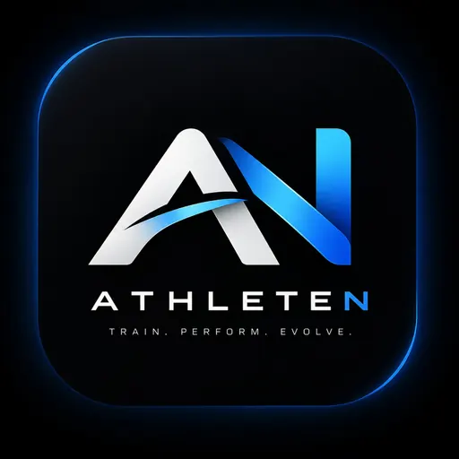
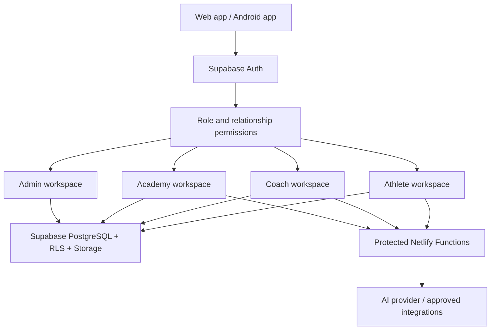

<div align="center">



# AthleteN

### THE ATHLETE OPERATING SYSTEM

**Train Smarter. Compete Stronger.**

<p>
  
  
  
  
</p>

**Built by Nova Code**

[Open AthleteN](https://athleten.netlify.app) · [Documentation](./docs/README.md) · [Mobile Guide](./AthleteN-Mobile/README.md) · [Release Candidate #59](https://github.com/NovaCode2026/AthleteN/pull/59)

</div>

---

> **Release status — candidate, not production-approved:** PR #59 remains unmerged and undeployed. Database reconciliation, security review, AI budget setup, signed Android distribution, billing validation and real-device acceptance are still required. Paid checkout remains disabled. See the [release-readiness report](./docs/RELEASE_READINESS_2026-11-12.md).

## What is AthleteN?

AthleteN brings an athlete's training life into one connected workspace. Athletes can keep their sports records organised, coaches can manage their authorised athlete groups, and academies can coordinate their teams.

The product is **Taekwondo-first**. Athletes choose Taekwondo and then select the discipline that applies to them:

- **Kyorugi** — sparring training, bout records and competition results.
- **Poomsae** — forms practice, repetitions, categories, scores and placings.

The platform follows one connected journey:

<div align="center">

**TRAIN** → **TRACK** → **PREPARE** → **COMPETE** → **REVIEW** → **IMPROVE**

</div>

## The AthleteN experience

| Workspace | What it helps people do |
|---|---|
| 🥋 **Athlete** | Maintain a profile, log training, track goals, record competitions and medals, organise documents and follow progress. |
| 🧑‍🏫 **Coach** | Work with an authorised roster, review training, manage attendance and follow athlete progress. |
| 🏟️ **Academy** | Coordinate athlete and coach memberships, attendance, competition activity and academy operations. |
| 🛡️ **Administration** | Review verification, manage platform access and oversee supported operational controls. |

### Connected athlete tools

- Training sessions, training history and progress summaries
- Taekwondo discipline-specific workspaces for Kyorugi and Poomsae
- Competition calendar, match records and event history
- Medals, certificates, milestones and athlete journey
- Goals, attendance, weight records and personal documents
- Coach and academy relationships, messaging and notifications
- Analytics and role-specific reports where the account is eligible

### AthleteN Intelligence

AI-assisted match and monthly reports are designed to summarise information that is actually recorded in AthleteN. They must not invent match events, performance statistics or video analysis. Role, subscription, usage and data-scope checks belong on the server—not only in the interface.

**Current operating gate:** AI generation remains fail-closed until the candidate budget-ledger migration is safely reconciled and installed, and production model access and costs are verified.

## Web and Android

| Client | Technology | Best suited to |
|---|---|---|
| 🌐 **Web** | React, TypeScript, Vite | Detailed dashboards, history, analytics, reports and administration |
| 📱 **Android** | React Native, Expo SDK 57, Expo Router | Quick daily checks, training capture, competition preparation and mobile tasks |

Both clients use the same account identity, shared backend records and server-side permission rules. The feature set is still being validated across devices; do not assume parity simply because a screen or navigation item exists.

## Plans

Approved customer-facing catalogue in INR:

| Plan | Monthly | Annual | AI requests / month |
|---|---:|---:|---:|
| Free | ₹0 | ₹0 | 0 |
| Pro | ₹99 | ₹999 | 50 |
| Elite | ₹199 | ₹1,999 | 200 |
| Coach | ₹499 | ₹4,999 | 750 |
| Academy | ₹799 | ₹7,999 | 1,000 shared |

**Student is legacy-only** for existing subscribers. It is not available for new purchases and is not part of the public launch catalogue.

Displayed prices are intended as customer totals inclusive of applicable GST; GST must not be added on top. The exact tax treatment and invoice requirements require qualified Indian tax review before checkout is enabled. Annual billing is not active yet. **Paid checkout and recurring billing remain disabled.**

See [Plans, Verification & Billing](./docs/PLAN_VERIFICATION_AND_BILLING.md) and [Pricing & Financial Controls](./docs/PRICING_AND_FINANCIAL_CONTROL_V1.md).

## How the platform is put together



### Technology stack

- **Web:** React 18, TypeScript, Vite and Recharts
- **Mobile:** React Native, Expo SDK 57 and Expo Router
- **Backend:** Supabase Auth, PostgreSQL, Row Level Security and Storage
- **Server functions:** Netlify Functions
- **AI:** server-side OpenAI API integration
- **Quality and delivery:** GitHub Actions, automated tests, CodeQL and Android build workflows

## Run the project locally

### Requirements

- Node.js 22 (the repository version is recorded in `.nvmrc`)
- npm and Git
- Android Studio/emulator or an Android device for mobile work
- Supabase project URL and public client key for connected features

### 1. Web application

From the repository root:

```bash
nvm install
nvm use
npm ci
npm run dev
```

Create a production web build:

```bash
npm run build
```

### 2. Android application

```bash
cd AthleteN-Mobile
npm ci
npx expo start --clear
```

To open the Android target:

```bash
npx expo start --android
```

For a local native Android build:

```bash
npx expo run:android
```

## Environment and secrets

The web client uses public Supabase configuration:

```env
VITE_SUPABASE_URL=
VITE_SUPABASE_ANON_KEY=
```

Mobile public configuration is documented in [AthleteN-Mobile/.env.example](./AthleteN-Mobile/.env.example).

Server-only values belong in the appropriate Netlify environment context. This includes the Supabase service-role key, OpenAI API key, payment-provider secrets and webhook-signing secrets. **Never place these values in `VITE_*`, `EXPO_PUBLIC_*`, source code, screenshots or Git commits.**

## Quality checks

Run the web checks from the repository root:

```bash
npm test
npm run build
```

Run the mobile checks from `AthleteN-Mobile`:

```bash
npx tsc --noEmit
npx eslint .
npx expo-doctor
```

These checks validate source and build behaviour. They do not replace two-account testing, production database verification, Android signing or physical-device acceptance.

## Repository map

```text
AthleteN/
├── src/                         Web application
├── AthleteN-Mobile/              Expo / Android application
├── netlify/functions/            Server-side API functions
├── supabase/migrations/          Versioned database migrations
├── supabase/security/            Security review SQL
├── tests/                        Automated regression tests
├── docs/                         Product, engineering and release guides
├── public/                       Web assets and branding
└── .github/workflows/             CI, security and Android workflows
```

## Documentation

| Start here | Read this for |
|---|---|
| [Documentation Hub](./docs/README.md) | A guided index of product, development, security and release documentation |
| [Platform Guide](./docs/ATHLETEN_PLATFORM_GUIDE.md) | Athlete, Coach and Academy workspaces and feature boundaries |
| [Taekwondo Disciplines](./docs/TAEKWONDO_DISCIPLINES.md) | Kyorugi and Poomsae workflows |
| [Web + Mobile Experience Model](./docs/WEB_MOBILE_EXPERIENCE_MODEL.md) | Shared data contracts and cross-platform acceptance |
| [Plans, Verification & Billing](./docs/PLAN_VERIFICATION_AND_BILLING.md) | Public plans, legacy Student handling and billing gates |
| [Pricing & Financial Controls](./docs/PRICING_AND_FINANCIAL_CONTROL_V1.md) | Approved prices, AI budget and commercial controls |
| [Architecture](./docs/Architecture.md) · [API](./docs/API.md) | Service boundaries and server endpoints |
| [Development](./docs/Development.md) · [Deployment](./docs/Deployment.md) | Local setup and controlled deployment |
| [Security](./docs/SECURITY.md) | Authentication, secrets and data access expectations |
| [Release readiness](./docs/RELEASE_READINESS_2026-11-12.md) | Current blockers and evidence required for sign-off |
| [Migration history drift](./docs/MIGRATION_HISTORY_DRIFT_2026-11-13.md) | Production/local migration inventory and reconciliation notes |
| [Mobile README](./AthleteN-Mobile/README.md) | Expo setup and Android validation |

## Release principles

AthleteN uses evidence-based release decisions:

1. A feature is not complete merely because its screen exists.
2. A passing CI run is not the same as production acceptance.
3. Database migrations must be reconciled and tested before production DDL.
4. Role and relationship access must be verified at the database/server boundary.
5. Payments stay disabled until tax, provider, webhook and recurring-billing requirements are tested.
6. Android store release requires verified package identity, signing and physical-device QA.

**AthleteN — one connected operating system for the athlete journey.**

<div align="center">

Made by **Nova Code** · [Repository](https://github.com/NovaCode2026/AthleteN)

</div>
