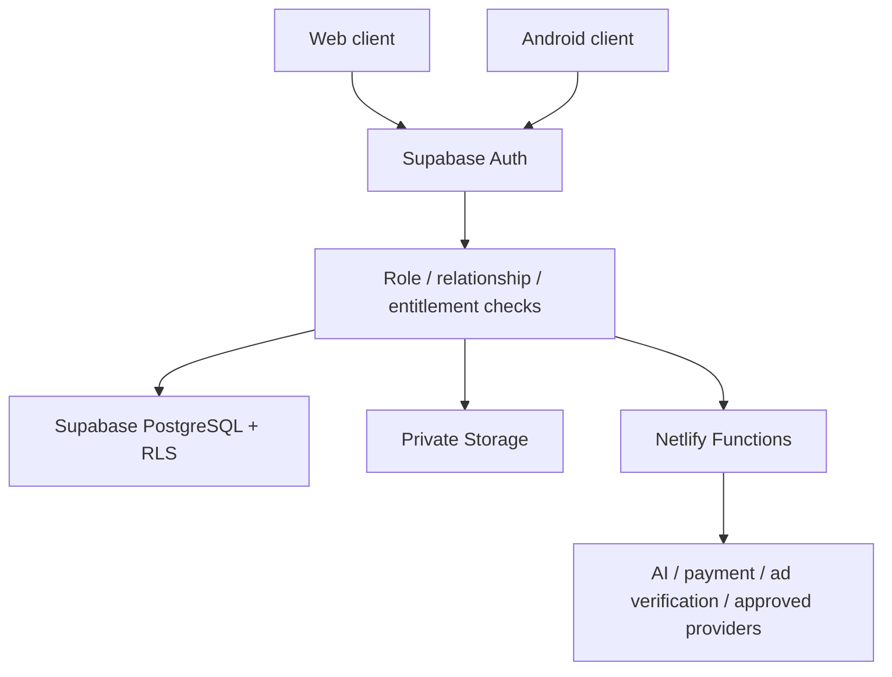

# AthleteN Architecture

**Updated:** 27 November 2026

AthleteN is a multi-client athlete platform. Web and Android clients share identity, canonical records and authorization boundaries through Supabase and server APIs.

## System layers

- **Web shell:** Vite and React mount the browser application.
- **Web experience:** React/TypeScript routes and workspace screens for Athlete, Coach, Academy and scoped Admin functions.
- **Mobile:** React Native, Expo SDK 57 and Expo Router.
- **Authentication:** Supabase Auth and client session handling.
- **Data access:** Supabase client/service modules and shared record workflows.
- **Database:** PostgreSQL, Row Level Security, functions, migrations and Realtime.
- **Private files:** Supabase Storage with access governed by authorization.
- **Server APIs:** Netlify Functions for protected operations, AI, billing and external provider workflows.
- **External services:** OpenAI and approved integrations; provider secrets remain server-side.

## Conceptual data flow

## Authorization model

AthleteN supports Athlete, Coach, Academy Admin and scoped platform administration. A user's access depends on identity, role, relationship, workspace, record ownership, verification and applicable entitlement.

- UI visibility is only a convenience.
- Server functions validate authenticated identity and authorization.
- PostgreSQL RLS and grants protect data.
- Sensitive operations should be reasoned, bounded and audited.
- Guardian approval flows do not independently prove adult identity or legal guardianship.

## Shared records and parity

Web and Android are separate experiences over the same authoritative data. Supabase/PostgreSQL is the canonical record store; Web is not a separate database authority.

A save on one client should be verified by read/refresh on the other. Realtime is an optimization for freshness, not the only correctness mechanism.

## AI boundary

AI requests are server-side. The client must not receive provider credentials. AI features require applicable role, entitlement, data-scope, usage and budget checks. The system should fail closed when budget configuration or required migrations are unavailable.

## Payments and rewarded ads

- Server-side price selection and entitlement activation are authoritative.
- Provider webhooks must be signature-verified and idempotent.
- Rewarded-ad credits must be issued only after verified provider callbacks.
- Both systems remain gated until configuration, tests and policy acceptance pass.

## Database and release safety

Candidate migrations must be reviewed and replayed in isolated staging. Production migration-history drift is a release gate; do not blindly push/reset or alter the live migration ledger.

See [Release Status](./RELEASE_STATUS_2026-11-27.md), [Security](./SECURITY.md) and [Release Checklist](./RELEASE_CHECKLIST.md).
