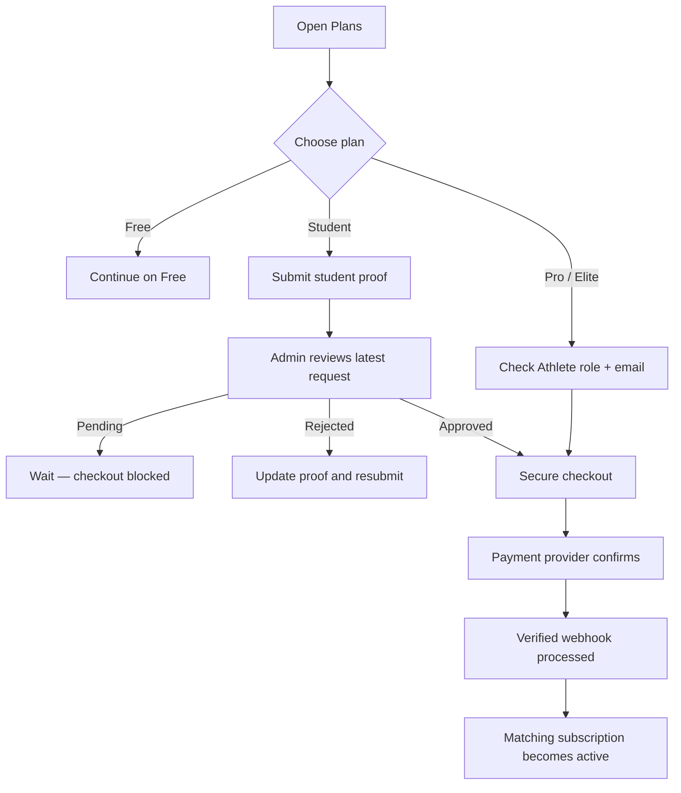
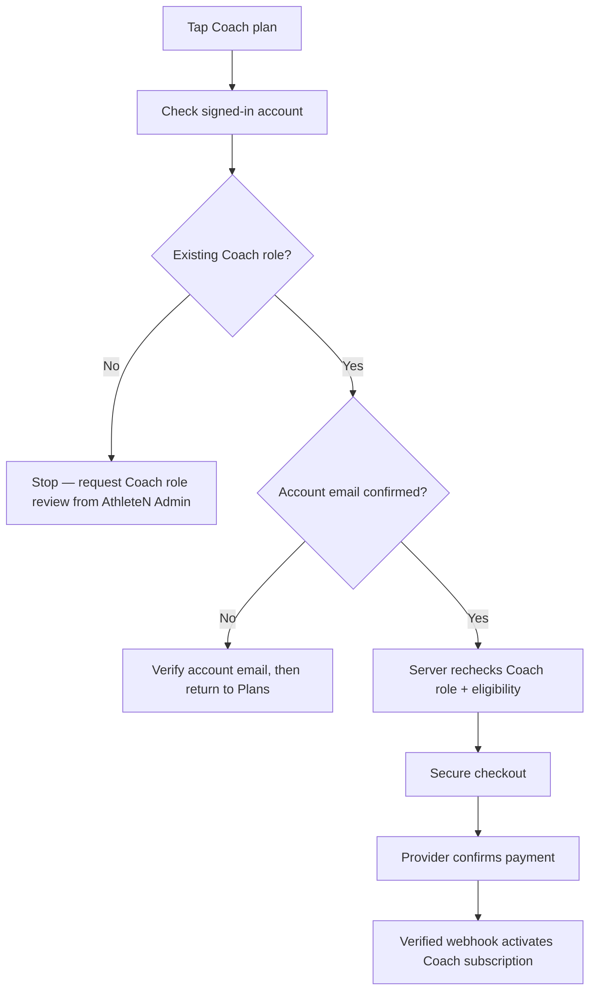
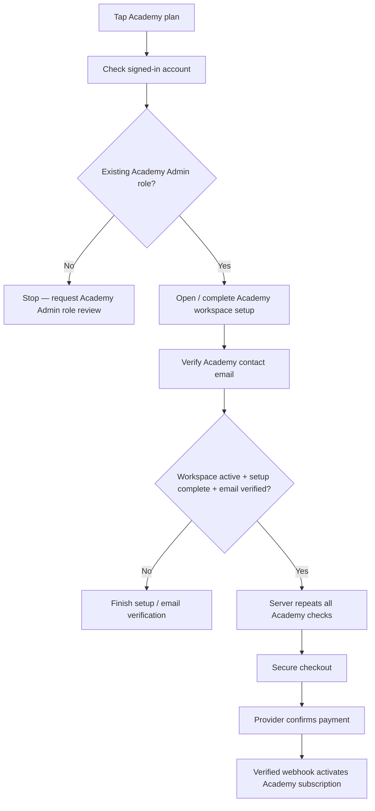

# 💳 AthleteN Plans, Verification & Billing

**Understand your plan. Verify your account. Pay securely. Unlock the right workspace.**

---

## 🧭 The big picture

AthleteN keeps three things separate:

| Stage | What it proves | Does it unlock paid features? |
|---|---|---|
| 🪪 **Account verification** | The account is eligible for the selected product | Not by itself |
| 💳 **Payment confirmation** | The payment provider confirms the payment | Not until the server processes it |
| 🚀 **Active subscription** | AthleteN records an active subscription for the matching role and plan | Yes, subject to the plan's permissions |

**Important:** tapping a plan, submitting proof, passing verification, or returning from a payment page must never activate a paid subscription by itself. Only a verified payment event can do that.

## 🎨 Plan catalogue

| Plan | Monthly | Yearly | AI requests / month | Designed for |
|---|---:|---:|---:|---|
| 🆓 **Free** | ₹0 | ₹0 | 0 | Getting started |
| 🚀 **Pro** | ₹99 | ₹999 | 50 | Athletes |
| 🏆 **Elite** | ₹199 | ₹1,999 | 200 | Competitive Athletes |

Student remains a legacy plan for existing approved subscribers only. It is not available for new purchases.
| 🧑‍🏫 **Coach** | ₹499 | ₹4,999 | 750 | Verified Coach accounts |
| 🏟️ **Academy** | ₹799 | ₹7,999 | 1,000 | Verified Academy Admin accounts |

Prices and quotas are the current product catalogue. Confirm provider billing intervals, tax treatment, renewal and cancellation terms before enabling public paid checkout.

### What paid plans unlock

- **AI Match Reports:** structured review based on supplied match information and recorded observations.
- **AI Monthly Reports:** role-specific summaries for the previous completed calendar month.
- **Monthly AI allowance:** each plan has a defined request limit.
- **Role workspace:** Coach and Academy plans are tied to the matching account role and its permitted athlete relationships.

AI reports are advisory. They must not invent match events, attendance, heart-rate data, technique statistics or medical conclusions.

## 🥋 Athlete purchase journey

**Legacy Student proof:** School ID, fee receipt or bonafide certificate may remain in historical records. Only an authorized platform Admin can approve or reject existing Student verification requests. This workflow preserves existing entitlements; it does not make Student available for new purchases.

## 🧑‍🏫 Coach purchase journey

The Coach button should start with verification, then continue to payment only when every check passes.

### Coach verification checklist

- Signed-in account is the intended Coach account.
- Existing account role is `coach`.
- AthleteN account email is confirmed.
- Server repeats the role and account checks before creating a payment order.
- Payment provider confirms payment.
- The webhook activates the Coach subscription; the client cannot set the plan directly.

**If your account is not yet a Coach account:** selecting the Coach plan does not turn an Athlete account into a Coach account. Contact the platform Admin to have the existing Coach account role reviewed/assigned. Do not create a duplicate Coach verification request system unless the product team explicitly approves a separate application workflow.

## 🏟️ Academy purchase journey

### Academy verification checklist

- Signed-in account has the existing `academy_admin` role.
- An Academy workspace exists and is owned by that account.
- Academy status is `active`.
- `setup_completed = true`.
- `contact_email_verified_at` is not null.
- The selected workspace matches the profile's Academy relationship when one is set.
- The server repeats these checks before creating a payment order and again during subscription activation.

If setup is incomplete, the user should be directed to the existing Academy setup flow. If the role is missing, the user must request role review from an authorized Admin.

## 🔐 State machine

| Account / payment state | Meaning | Checkout |
|---|---|---|
| Role not eligible | Wrong account type or role not assigned | Blocked |
| Email unconfirmed | Account email not verified | Blocked |
| Student proof pending | Admin review not finished | Blocked |
| Academy setup incomplete | Workspace or contact verification missing | Blocked |
| Eligible / verified | Required account checks passed | Allowed |
| Checkout pending | Payment has not been confirmed | No paid access |
| Payment failed / cancelled | Provider did not confirm payment | No paid access |
| Active subscription | Verified payment has been processed | Paid access |
| Expired / cancelled / past due | Subscription is no longer active | Paid access blocked |

## 🧱 Engineering enforcement map

| Layer | Responsibility |
|---|---|
| 🌐 Web Plans page | Explains products, checks eligibility, starts checkout |
| 📱 Android Plans screen | Same product journey with native navigation and provider hand-off |
| 🛡️ Supabase Auth | Identifies the signed-in account |
| 🗃️ PostgreSQL + RLS | Protects verification, subscription and report records |
| ⚙️ Netlify checkout function | Rechecks role, email and verification before creating an order |
| 💰 Payment provider | Hosts the payment experience and reports payment status |
| 🔔 Payment webhook | Validates provider signature and processes the payment event |
| 🔐 Subscription activation function | Rechecks role-specific verification and activates the matching plan |
| 🤖 AI endpoint + report policies | Requires matching active subscription, role and applicable verification |

### Key implementation files

- `src/config/plans.ts` — web plan catalogue.
- `AthleteN-Mobile/src/app/plans.tsx` — Android plan screen and checkout hand-off.
- `AthleteN-Mobile/src/app/verification.tsx` — Student proof submission and history.
- `AthleteN-Mobile/src/app/academy-setup.tsx` — existing Academy setup workflow.
- `netlify/functions/create-checkout.mjs` — server-side checkout and eligibility checks.
- `netlify/payment-common.mjs` — shared payment helpers, prices and verification.
- `netlify/functions/payment-webhook.mjs` — provider event handling.
- `netlify/functions/ai-coach.mjs` — AI role, subscription and quota checks.
- `src/components/reports/IntelligenceReportsPage.tsx` — AI report generation and history.
- `supabase/migrations/` — schema, RLS and subscription enforcement.

## 🧪 Required acceptance tests

Before paid launch, test each journey with separate test accounts:

- [ ] Existing Student subscriber retains the historical Student entitlement.
- [ ] New Student checkout is rejected regardless of verification status.
- [ ] Pro and Elite checkout remain blocked while the global paid-launch gate is closed.
- [ ] Athlete account selecting Coach → blocked; no automatic role change.
- [ ] Coach role + unconfirmed account email → blocked.
- [ ] Coach role + confirmed email → checkout can start.
- [ ] Academy Admin with no workspace → sent to Academy setup; checkout blocked.
- [ ] Academy with incomplete setup → checkout blocked.
- [ ] Academy with unverified contact email → checkout blocked.
- [ ] Fully verified Academy Admin → checkout can start.
- [ ] Payment cancelled or failed → no paid subscription.
- [ ] Forged browser success URL → no paid subscription.
- [ ] Valid provider webhook → matching subscription activates once.
- [ ] Duplicate webhook → idempotent; no duplicate activation.
- [ ] Expired/cancelled subscription → paid AI report access blocked.
- [ ] Cross-role and cross-user report reads/inserts are denied.

## 🚦 Current launch limitation

The repository's `FREE_LAUNCH` switch in `netlify/functions/create-checkout.mjs` intentionally blocks paid checkout while Free Launch is active. Therefore, the documented journey describes the intended verified purchase flow, but live payment cannot complete until the owner deliberately enables the payment launch gate, configures provider credentials and recurring plan IDs, and passes sandbox and production acceptance tests.

**Never remove the launch gate just to make a button appear to work.** A safe blocked checkout is better than accepting payment without a complete subscription lifecycle.

---

**AthleteN — verify first. Pay securely. Train smarter.**

